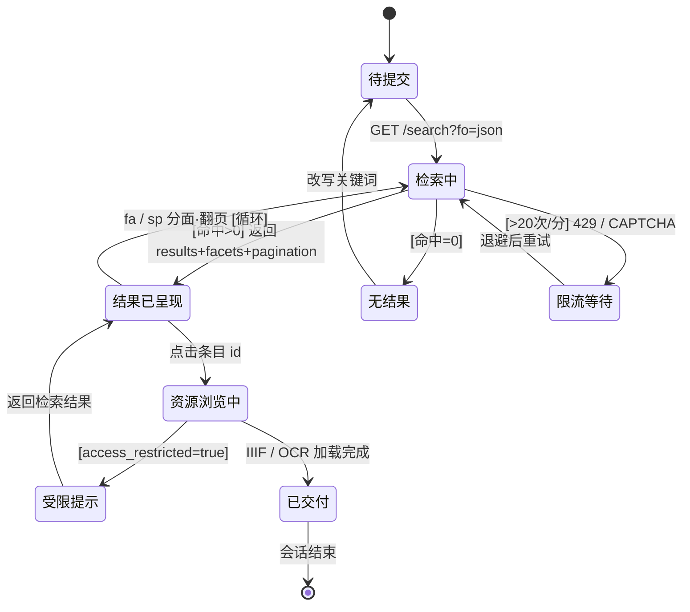
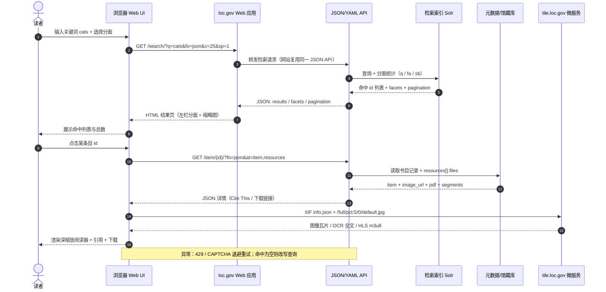
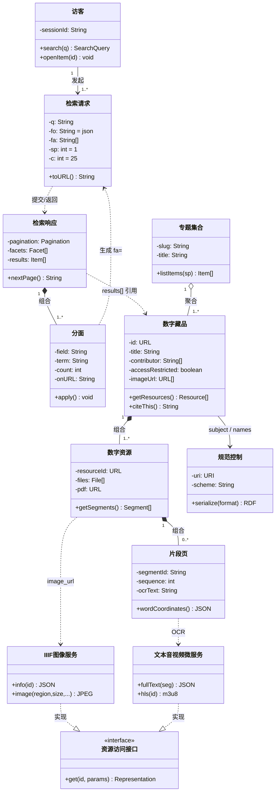
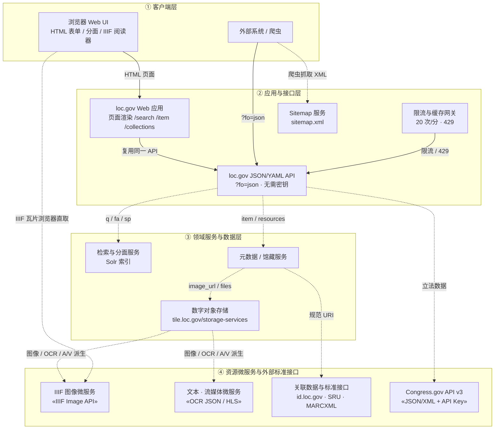

<!-- 1113 作业：美国国会图书馆网站系统分析；图见 diagrams/ 目录 -->

# 美国国会图书馆网站（loc.gov）系统分析与设计作业

**课程**：《信息系统分析与设计》 · **作业**：1113 作业 · **姓名**：顾金昊　**学号**：2503408044　**日期**：2026-11-20

**作业原文（仓库 `1113作业.md`）**：「对照今天课程内容的领域对象建模、系统应用架构设计、接口层设计中的原则、要求及案例内容，分析美国国会图书馆网站的：状态图、交互图、类图、构件图，及其软件架构体系和设计模式。」微信补充要求：把它当成一个系统／一个软件来分析应用架构；并结合第十一章接口设计，判断网站采用的是哪一种接口技术。[1]

## 0　先说明：分析对象、材料与判断口径

这里把 **www.loc.gov 整个网站当作一个信息系统（软件）**，而不是只分析某个页面。所谓「架构」，就是回答课件第 10 章的问题：系统怎么分层、模块怎么划分、模块之间通过什么接口协作、非功能需求（性能、可用性）怎么落到设计上。[2][3]

材料来源有三类：① 课程课件 `2.pdf`（本机打开异常，已直接从 PDF 内嵌页提取出第 8、10、11、12 章课件页，其中「信息系统接口」一页明确写出接口层一般设计**两种接口**）；② 课程数字教材第 4 章与附录 H 建模速查[2][3]；③ 美国国会图书馆官方 API 文档与页面[4]–[20]。

> 判断口径：文中「官方明示」指官方技术文档直接写出的内容；「设计推断」指从这些公开接口反推的架构与模式，不把未公开的内部实现（具体语言、框架、服务器数量）当成事实。

## 1　一句话先看清这个系统

**loc.gov 不是「一个网页」，而是「一个以 JSON API 为数据中枢的数字馆藏服务系统」**：浏览器页面、第三方程序、爬虫都通过 HTTP 拿到同一套结构化数据；检索交给 Solr 索引；图像、OCR、音视频各由独立的微服务按标准 URI 提供；规范词表、目录、立法数据再通过 SRU / RDF / 独立 API 接入。[4][5][18]

官方原话可以直接作证：loc.gov JSON API「最初就是为驱动 loc.gov 网站而设计」，JSON 数据被用来构建 `/item`、`/collections/`、`/search/` 等页面；支撑检索引擎与 JSON API 的是同一套 **Solr schema**。[5][18] 这句话决定了后面所有图的画法——前端与后端之间本来就有一层稳定的接口契约。

## 2　四张 UML 图

### 2.1　状态图：一次检索请求的生命周期

状态图描述**一个对象**在生命周期里因事件发生的状态变迁（教材附录 H.3）。这里选的对象是「一次检索请求 SearchRequest」，因为它最能体现网站真实行为：正常路径、分面循环、限流兜底、空结果兜底。[6][8][9]

**图 1  状态图：一次检索请求（SearchRequest）的生命周期**

- **正常路径**：待提交 → 检索中 → 结果已呈现 → 资源浏览中 → 已交付 → 结束。
- **循环**：在结果页点分面 `fa=` 或翻页 `sp=`，请求回到「检索中」，这是最典型的状态回流。
- **兜底分支**：命中为 0 进入「无结果」并提示改写；超过 20 次/分返回 429 或 CAPTCHA 进入「限流等待」，退避后重试；资源 `access_restricted = true` 时进入「受限提示」再返回结果页。[9][19]
- **教材对应**：圆角矩形=状态、箭头=事件[条件]/动作、实心圆=初态、牛眼=终态（附录 H.3）。

### 2.2　交互图（顺序图）：读者检索并查看一件数字藏品

顺序图按时间顺序展示对象间的消息（附录 H.4）。下面把浏览器、Web 应用、JSON API、Solr、元数据库、微服务画成六条生命线，实线箭头为调用、虚线箭头为返回。[5][7][10][11]

**图 2  交互图（顺序图）：读者检索并查看一件数字藏品**

- 第 2–8 步是一次检索：`/search/?q=…&fo=json` → Solr 查询 → 返回 `results`、`facets`、`pagination` → 渲染 HTML 结果页。[7][8]
- 第 10–13 步是一次详情读取：`/item/{id}/?fo=json&at=item,resources` 拿到书目记录、`image_url`、`pdf`、`segments`。[7]
- 第 14–16 步是资源加载：浏览器直接向 `tile.loc.gov` 请求 IIIF `info.json` 与图像 URI，或取 OCR 全文 / HLS 流，最后由前端渲染深缩放阅读器、引用文本与下载链接。[10][11][12][19]
- **关键读点**：第 3 步「网站复用同一 JSON API」说明前后端是解耦的，不是页面里硬编码数据；这也是后面判定「API-first」的核心证据。[5][18]

### 2.3　类图：领域对象建模

类图刻画静态结构（附录 H.3：类、属性、操作、关联／聚合／组合／继承）。领域对象从官方 API 的字段名反推，不凭空造类：`item`、`resources`、`segments`、`facets`、`pagination`、`image_url`、`access_restricted` 都是真实返回字段。[7][9]

**图 3  类图：loc.gov 数字馆藏领域对象模型**

- **组合关系（实心菱形）**：`Item ◆— Resource ◆— Segment`，一件藏品含若干数字资源，一个资源（如一份报纸）含若干页／分段。
- **聚合关系（空心菱形）**：`Collection ◇— Item`，专题集合是人为按主题组织的分组，条目可以属于多个集合。
- **关联**：`Item — Authority`，主题、责任者指向 id.loc.gov 的可解析规范 URI；`SearchResponse — Item` 表示 `results[]` 只是条目的摘要引用。[15]
- **接口与实现（虚线空心三角）**：`«interface» 资源访问接口` 由 IIIF 图像服务、文本／音视频微服务实现，体现依赖倒置 DIP：领域对象只依赖稳定的 `get(id, params)` 契约（附录 H.5）。[10][11][12]
- 注：为控制图幅，Text Services 与 Streaming Services 合并成一个类；构件图里二者分开。

### 2.4　构件图：软件架构与接口层

构件图展示物理构件及其依赖（教材附录 B：带两个小矩形的矩形=构件；○—=提供接口；⊐=需求接口；虚线=依赖）。图上同时标出第 11 章强调的两类接口：**软件系统与人的接口**（浏览器界面）与**软件系统与软件系统之间的接口**（API／标准协议）。

**图 4  构件图：loc.gov 软件架构与接口层**

- **接入层**：浏览器与外部程序都走 HTTPS；网关承担限流（20 次/分）与 429 / CAPTCHA 兜底。[9]
- **应用／接口层**：Web 应用负责页面渲染，JSON/YAML API 提供 `«REST / JSON»` 接口，二者共享同一份数据契约。[5][18]
- **领域服务层**：Solr 检索与分面、元数据／馆藏服务、数字对象存储 `tile.loc.gov/storage-services` 各司其职。[9][18]
- **微服务层**：IIIF 图像、文本 OCR、A/V 流媒体三个「有限用途、轻量 API」的微服务独立提供能力（官方即称其为 microservices）。[4][10][11][12]
- **外部标准接口层**：id.loc.gov 关联数据、SRU / Z39.50、MARCXML / MODS / DC、Congress.gov API v3、XML Sitemap 并行存在。[13]–[17][19]

## 3　软件架构体系判断

**结论：B/S 多层架构 + API-first 的「模块化核心 + 微服务外围 + SOA 式异构集成」混合体系；既不是纯单体，也不是把所有功能都拆成微服务。**（官方明示 + 设计推断）

### 3.1　第一层：B/S 与经典分层

- **表示层**：浏览器中的 HTML 页面、检索表单、左侧分面栏、条目页与 IIIF 阅读器（人机接口）。[19]
- **应用／接口层**：loc.gov Web 应用 + JSON/YAML API；二者复用同一数据，属于前后端分离。[5][18]
- **领域／数据层**：Solr 索引、元数据／馆藏库、数字对象存储。[9][18]
- **基础设施层**：`tile.loc.gov` 微服务群、限流与缓存、Sitemap。[9][13]

### 3.2　第二层：API-first / 前后端分离（最关键的架构决策）

官方说明：JSON API 最初就是为了给网站供数据，JSON 被用来构建 `/item`、`/collections/`、`/search/` 页面；后来才把它开放给开发者、图书馆员与研究者。[5][18] 因此网站页面本身也是这个 API 的一个「客户端」。带来的好处正是课件第 10 章讲的可扩展性、可测试性、可部署性与可维护性：新增一种表示（2017 年增加 YAML）时不必改页面逻辑，符合**开闭原则 OCP**。[18]

### 3.3　第三层：按业务能力拆分的微服务

官方把 Text Services、Image Services、Streaming Services 明确称为 **microservices**：「有限用途、以轻量 API 完成单一职责的计算机系统」。[4] 它们分别挂在 `tile.loc.gov/text-services`、`/image-services/iiif`、`/streaming-services` 下，各自有独立限流额度（150 / 150 / 60 次每分）。[9]这是典型的**单一职责 SRP + 高内聚低耦合**：图像服务故障不必拖垮书目检索。

### 3.4　第四层：SOA 式的异构系统集成

国会图书馆不是一个孤立系统：目录记录走 SRU / CQL 与 Z39.50 网关，规范词表走 id.loc.gov 的 RDF / 关联数据，立法数据走需要 API Key 的 Congress.gov API v3，条目页还提供 MARCXML / MODS / Dublin Core 三种记录导出，爬虫走 XML Sitemap。[13]–[17][19] 这些是**跨系统、跨组织、跨协议**的能力复用，属于 SOA／面向服务集成，而不是同一套微服务网格。官方甚至提醒「并不存在统一的 API 响应」——不同数字化与编目实践导致数据结构高度异构。[5]这正说明系统里必须有适配／门面层。

### 3.5　非功能需求如何落到架构上（附录 A / H.8）

- **性能**：JSON/YAML API 20 次/分、微服务 150 次/分、流媒体 60 次/分、MARCXML 30 次/分；超限封锁 1 小时。[9]
- **容量**：单次查询深分页上限 100,000 条，建议每页不超过 1,000 条；鼓励用分面 `fa=` 缩小结果集。[8][9]
- **可用性 / 防滥用**：无需 API Key 即可访问，但以限流、429 与 CAPTCHA 防 DoS；高频时可能动态降低限额。[5][9]
- **可缓存性**：IIIF 与 A/V 服务把 region / size / rotation 等参数放在 URI 路径而非查询串，官方明确说明「更易被标准 Web 缓存基础设施缓存」。[10][12]
- **权利与合规**：条目带 `access_restricted` 与 Rights Advisory，权利受限时只展示缩略图。[19]

## 4　接口层设计与「采用了哪一种接口技术」的判断（重点）

### 4.1　先按第 11 章把接口分成两类

课件「信息系统接口」一页给出定义：**接口是事物与外界之间可交互的边界，外界可借接口与事物沟通而无需了解其内部操作**；并明确指出「信息系统接口层，一般设计两种接口：① 软件系统与人的接口；② 软件系统与软件系统之间的接口」。所以这道题不能只答一个 API 名字，必须把两类都指出来。

### 4.2　第一类：软件系统与人的接口（人机接口 / Web GUI）

- 检索框、分面筛选栏（左侧 facets）、排序、翻页、专题集合页、条目详情页；[8][19]
- IIIF 深缩放图像阅读器、OCR 全文定位、音视频播放器、Cite This 自动引用、MARCXML / MODS / DC 下载链接；[10][11][12][19]
- 技术上就是 **B/S 浏览器图形界面（HTML/CSS/JS + HTTP）**，属于表示层，不是系统间接口。

### 4.3　第二类：软件系统与软件系统之间的接口（技术清单）

| 接口 / 服务 | 协议与数据格式 | 典型 URL 或参数 |
| --- | --- | --- |
| loc.gov JSON/YAML API | HTTP GET + 查询串；JSON / YAML | `https://www.loc.gov/{endpoint}/?fo=json`；`q / fa / sp / c / sb / at` |
| IIIF 图像微服务 | IIIF Image API 2.x；URI 模板 + `info.json` | `https://tile.loc.gov/image-services/iiif/{id}/{region}/{size}/{rotation}/{quality}.{format}` |
| 文本 / 流媒体微服务 | OCR 词坐标 JSON；HLS `.m3u8` / `.mp4` | `tile.loc.gov/text-services/...?format=alto_xml&full_text=1` |
| 目录与规范数据 | SRU / CQL + Z39.50；RDF/XML、JSON-LD、Turtle、N-Triples；MARCXML / MODS / DC | `id.loc.gov`（HTTP `Accept` 内容协商）、`lccn.loc.gov/{id}/marcxml` |
| 其他开放接口 | XML Sitemap；Congress.gov API v3（JSON / XML，需 API Key） | `loc.gov/sitemap.xml`、`api.data.gov/congress/v3?api_key=` |

### 4.4　判断结论

> **主体接口技术 = 面向资源的 REST 风格 HTTP API（REST/HTTP + JSON），不是 SOAP、不是 GraphQL、不是 RPC。**外围同时叠加 IIIF 标准图像 API、HLS 流媒体、SRU/CQL 与 RDF 关联数据等**行业标准协议接口**；人机接口则是浏览器 Web GUI。

为什么判为 REST 风格（而不是别的）：

1. **资源化 URL**：`/search/`、`/collections/{slug}`、`/item/{id}/`、`/resource/{id}/` 都是「用 URL 指称资源」，同一个 URL 加 `?fo=json` 就返回该资源的 JSON 表示。[6][7]
2. **统一接口 + 无状态**：全部通过 HTTP GET 与查询参数表达操作（`q` 关键词、`fa` 分面、`sp` 页码、`c` 每页条数、`sb` 排序、`at` 字段裁剪），请求之间不依赖会话状态，且**无需 API Key 或认证**。[5][8]
3. **可协商表示**：`fo=json` / `fo=yaml` 由同一资源返回不同表示，属于内容协商式的表示层设计。[8][18]
4. **可缓存、可分页**：响应含 `pagination`、`facets`、`results`；官方文档专门给出缓存友好 URI 与分页／限流约束。[7][9][12]

**边界说明**：严格的 REST 成熟度模型还要求 HATEOAS 超媒体链接与完整的 CRUD 动词；loc.gov 公开接口以只读 GET 为主，所以它更准确的叫法是「**面向资源的 REST 风格 Web API（准 RESTful）**」。此外，SRU/CQL、Z39.50、MARCXML 属于传统图书馆领域的 **XML/协议型 SOA 接口**，id.loc.gov 属于 **RDF / Linked Data 接口**，IIIF 属于**行业标准图像 API**——它们是补充，不推翻主体判断。[15][16][10]

### 4.5　接口设计原则对照（第 11 章 + 附录 H.6）

- **接口即边界**：外界只需知道 `?fo=json` 与参数契约，不必知道后端是 Solr、元数据库还是对象存储。[6]
- **契约稳定、依赖抽象**：页面与第三方程序都依赖同一 URL 契约，底层实现可替换（DIP）。[5][18]
- **最小必要信息**：`at=` 可只取 `item,resources` 等字段，避免把整份大对象传给调用方——对应低耦合里的「数据耦合」。[8]
- **面向业务能力定义系统操作**：检索、取集合、取条目、取资源、取图像／OCR／流，各自对应一个明确接口（附录 H.6）。[4][7]

## 5　设计模式分析

以下把课程的 SOLID / GoF 23 种模式（附录 H.5）与实际设计一一对应；带「推断」的是由公开接口反推，非官方命名。

| 模式 / 原则 | 在 loc.gov 中的落点 | 好处 |
| --- | --- | --- |
| MVC / 分层架构（架构模式） | 视图=浏览器页面与 IIIF 阅读器；控制器=Web 应用；模型=JSON API 与领域对象[5][18] | 表示与数据解耦，页面可独立改版 |
| 外观 Facade | JSON/YAML API 把 Solr、元数据、对象存储、三种微服务统一成一个门面[5][7] | 调用方只面对一个契约，内部可演进 |
| 适配器 Adapter（推断） | 异构编目格式 MARC / MODS / DC / EAD 与规范词表被整理成统一 JSON 字段；官方称「没有统一响应」[5][15][19] | 屏蔽历史系统差异，兼容老标准 |
| 策略 Strategy | `fo=json\|yaml` 表示策略、`sb=date\|title_s\|…` 排序策略、IIIF 的 region/size/rotation 参数化派生[8][10] | 新增表示或派生方式无需改调用方（OCP） |
| 代理 / 限流 Proxy | 网关限流 20 次/分、429 与 CAPTCHA；缓存友好 URI[9][12] | 保护后端、提升可用性 |
| 组合 Composite | `Item → Resource → Segment` 的树形结构，报纸一期含多页[7] | 统一处理单件与多页对象 |
| 迭代器 Iterator | `sp` 翻页、`c` 每页条数、`at` 属性选择[8][9] | 大结果集可控遍历，避免深分页 |
| 单一职责 SRP / 依赖倒置 DIP | Text、Image、Streaming 三个微服务各管一件事；前端只依赖 `«REST/JSON»` 抽象接口[4][3] | 高内聚低耦合、故障隔离、易替换 |

特别值得写进作业的一句：**2017 年新增 YAML 表示而没有改页面逻辑，是开闭原则 OCP 的真实案例**——对扩展开放（加一种表示），对修改封闭（不动已有 JSON 客户端）。[18]

## 6　对照课程原则的自检

- **模块化 / 高内聚低耦合**：表示、检索、元数据、对象存储、图像、文本、音视频按职责分层，模块之间通过少量明确接口协作。[4][5]
- **可复用**：同一 JSON API 同时服务网站页面、第三方程序与研究脚本；同一 IIIF URI 同时服务网站阅读器与外部引用。[5][10]
- **易维护 / 变更局部化**：新增格式、新增集合、新增微服务消费者都不必改动其他层；限流与分页约束写进接口契约。[8][9][18]
- **非功能即隐性需求**：限流、深分页上限、缓存友好 URI、权利受限标记都在设计阶段就落位，而不是上线后补（附录 H.8）。[9][12][19]
- **接口层两类齐全**：人机接口（Web GUI）与系统间接口（REST/JSON + 标准协议）都能在构件图上指出位置。

## 7　结论

把 loc.gov 当成一个软件看，它的骨架是：**浏览器 / Web 应用 / JSON API / 领域服务 / 资源微服务 / 外部标准服务**的 B/S 多层结构；最关键的架构决策是 **API-first**——网站自己就是 JSON API 的客户端；最关键的接口技术是**面向资源的 REST 风格 HTTP + JSON**，并由 IIIF、HLS、SRU、RDF、MARCXML、Sitemap 等行业标准接口补齐外围；设计上反复体现外观、适配器、策略、代理、组合等 GoF 模式与 SOLID 原则。四张图分别回答了「一个对象怎么变」（状态图）、「一次请求怎么走」（交互图）、「系统里有哪些对象」（类图）、「系统由哪些构件、通过什么接口拼起来」（构件图）。

---

## 参考资料（均为 2026-11-20 核对）

1. [1] 课程作业原文：`ISAD/1113作业.md` — https://github.com/DSDH-ar/ISAD/blob/main/1113%E4%BD%9C%E4%B8%9A.md
2. [2] 数字教材 第4章《系统总体设计与智能体架构》— https://dsdh-ar.github.io/ISAD/html%E6%95%99%E6%9D%90/ch04.html
3. [3] 数字教材 附录 B / H（UML 速查、SOLID、GoF、SOA / API）— https://dsdh-ar.github.io/ISAD/pages/appendix.html#modeling
4. [4] APIs for LoC.gov（三类 API 与 microservices 定义）— https://www.loc.gov/apis/
5. [5] JSON/YAML for LoC.gov（API 为网站供数据、免密钥、异构数据）— https://www.loc.gov/apis/json-and-yaml/
6. [6] Making API Requests / Base URL — https://www.loc.gov/apis/json-and-yaml/requests/
7. [7] API Endpoints（/search、/collections、/item、/resource 与响应字段）— https://www.loc.gov/apis/json-and-yaml/requests/endpoints/
8. [8] API Request Parameters（fo / q / fa / c / sp / sb / at）— https://www.loc.gov/apis/json-and-yaml/requests/parameters/
9. [9] Working Within Limits（限流、深分页、429 / CAPTCHA）— https://www.loc.gov/apis/json-and-yaml/working-within-limits/
10. [10] Image Services（IIIF Image API）— https://www.loc.gov/apis/micro-services/image-services/
11. [11] Text Services（OCR 全文、词坐标、片段）— https://www.loc.gov/apis/micro-services/text-services/
12. [12] Streaming Services（HLS / m3u8、缓存友好 URI）— https://www.loc.gov/apis/micro-services/streaming-services/
13. [13] Sitemaps — https://www.loc.gov/apis/sitemaps/
14. [14] Additional APIs and Data Services — https://www.loc.gov/apis/additional-apis/
15. [15] Linked Data Service（id.loc.gov）— https://www.loc.gov/apis/additional-apis/linked-data-service/ ；技术中心 https://id.loc.gov/techcenter ；批量序列化 https://id.loc.gov/download/
16. [16] Search/Retrieval via URL（SRU / CQL / Z39.50）— https://www.loc.gov/apis/additional-apis/search-retrieval-via-url/
17. [17] Congress.gov API（v3、需 API Key、JSON/XML）— https://www.loc.gov/apis/additional-apis/congress-dot-gov-api/
18. [18] The Signal：Library of Congress on the Web（2011 建 JSON API、Solr schema、2017 加 YAML）— https://blogs.loc.gov/thesignal/2023/06/library-of-congress-on-the-web/
19. [19] 条目页实例（MARCXML / MODS / DC、Cite This、Rights）— https://www.loc.gov/item/2014717546/
20. [20] 课程课件 `2.pdf`（本机文件，含第 8 章领域对象建模、第 10 章系统应用架构、第 11 章接口层设计、第 12 章面向对象设计页）

**配图文件**：`diagrams/01_状态图.svg|png`、`02_交互图.svg|png`、`03_类图.svg|png`、`04_构件图.svg|png`，按教材附录 B 的 UML 符号规范绘制；本文附带的 Mermaid 源码可直接粘贴到 GitHub Markdown 中渲染。
