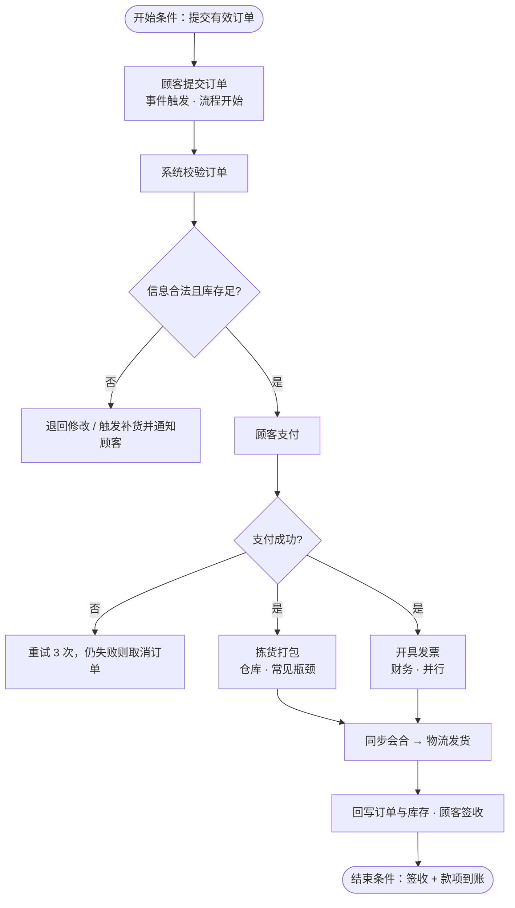

# 第 6 章 流程建模

- 示例系统：**网上书店订单处理系统**
- 题目范围：PPT 第 3 页（数据流分析 7 问）+ 第 36 页（业务流程分析 7 问）
- 使用专家：**流程图思维导图**
- 姓名：**顾金昊**　学号：**2503408044**　日期：**2026-11-6**

---

## 一、作业要求

1. 在 AI 平台上**找一个专家** → 已选「流程图思维导图」（业务流程图 / 数据链路 / 状态流转方向）。
2. **向专家提相关问题** → 见第二节的提问话术。
3. 让专家**画一张思维导图、一张流程图** → 见第四节两张图。
4. 让专家**列出调用的工具** → 见第五节工具清单。
5. **我自己回答** PPT 第 3 页、第 36 页的题目 → 见第六节 14 题逐题作答。
6. 这一整套流程就是一个 AI **技能 skill** → 见第七节。
7. 答案要**根据 AI 给的内容**来写 → 第三节列出专家答案要点，第六节的作答全部据此复述。

---

## 二、我该怎么向专家提问

> 我选的专家是「流程图思维导图」。请以《信息系统分析与设计》第 6 章「流程建模」为背景，用**网上书店订单处理系统**为例，帮我完成下面的作业：
>
> ① 逐题回答 PPT 第 3 页「数据流分析，需要回答以下问题」的 7 个问题；  
> ② 逐题回答 PPT 第 36 页「业务流程分析，需要回答以下问题」的 7 个问题；  
> ③ 画一张知识思维导图，把两页 14 问的关系串起来；  
> ④ 画一张业务流程图，要有判断、异常分支、并行、同步会合，并标出起止条件和瓶颈；  
> ⑤ 列出你这次调用了哪些工具；  
> ⑥ 说明什么是 AI 的技能 skill。

---

## 三、AI 专家给我的答案要点

- 先画**系统边界**，圈外是外部实体；数据流图四要素：外部实体、加工、数据存储、数据流。
- **自顶向下、逐层分解**：复杂功能拆成子功能，拆到「一句动宾短语说得清」为止，一般 2～3 层。
- **数据流守恒**：输出＝输入＋加工新增的信息；每个加工一进一出，每个存储一写一读，父图子图要平衡（防黑洞、奇迹、灰洞）。
- **控制流 ≠ 数据流**：控制流决定下一步走哪（判断、分支、循环、并行与会合），数据流负责搬数据。
- 业务流程分析的固定顺序：**流程清单 → 步骤与起止条件 → 参与者（泳道）→ 控制流 → 手段 → 资源成本增值 → 瓶颈**。
- **增值**＝改变状态且顾客愿意付钱；排队、等待、重复录入、返工都是浪费。**瓶颈**看队列长度、等待时间、利用率。

---

## 四、专家画的两张图（第 3 条要求）

### 图 1　第 6 章流程建模知识思维导图（层级结构）

- **中心：第 6 章 流程建模 · 网上书店订单系统**
  - **数据流分析（第 3 页 · 看数据）**
    - Q1 功能与输入输出
    - Q2 边界与外部环境
    - Q3-4 自顶向下分解
    - Q5 加工输入输出
    - Q6 存储与增删改查
    - Q7 来源去处完整
  - **业务流程分析（第 36 页 · 看事情）**
    - Q1 流程清单与目标
    - Q2 步骤与起止条件
    - Q3 参与者与泳道
    - Q4 控制流与关系
    - Q5 完成手段
    - Q6 资源成本增值
    - Q7 瓶颈与排队
  - **要交的东西（两张图一清单）**
    - 数据流图 DFD
    - 泳道业务流程图
    - 数据字典
    - 流程说明表
    - 完整性自查
  - **通用套路（怎么想不会乱）**
    - 先画系统边界
    - 自顶向下分解
    - 先正常后异常
    - 父图子图平衡
    - 数据不能凭空来

### 图 2　网上书店订单处理业务流程图

> 若预览器不支持 Mermaid，图 2 的文字序列是：提交订单 → 系统校验 → 判断信息合法且库存足（否：退回修改/触发补货）→ 顾客支付 → 判断支付成功（否：重试 3 次或取消）→ 并行「拣货打包」与「开具发票」→ 同步会合 → 物流发货 → 回写数据、顾客签收。

---

## 五、专家调用的工具清单（第 4 条要求，可照抄）

1. **图像识别 / 看图工具** —— 读取三张截图，转录聊天里 7 条要求与两页 PPT 的 14 道题目。
2. **专家目录检索** —— 按「流程建模 / 思维导图 / 流程图」匹配并启用「流程图思维导图」专家。
3. **章节知识库** —— 调取数据流分析、DFD、数据流守恒、泳道、增值与瓶颈等概念组织答案。
4. **可视化渲染 / SVG 绘图** —— 生成图 1 思维导图与图 2 业务流程图。
5. **文档生成 / 本地文件写入** —— 合成这份作业稿并导出 PDF。
6. **会话上下文与记忆** —— 保持「先给直观图、再讲原理、少堆大表格」，并让同一个示例系统贯穿全文。

> 本次**没有**联网检索、没有读数据库、没有跑业务代码；若平台上显示了工具调用记录，以实际记录为准替换名称即可。

---

## 六、我的作答：这 14 题我该怎么回答（第 5、7 条，可直接抄）

### 第 3 页 · 数据流分析，需要回答的 7 个问题

> **我的思路**：数据像快递包裹 —— 外部实体是寄件人/收件人，加工是分拣中心，数据存储是仓库，数据流是运输车。7 题就是把包裹的路线查清楚。

#### Q1　系统作为信息处理器主要完成什么功能？最重要的输入和输出数据是什么？

**我的作答：** 本系统的功能是把顾客提交的原始订单信息，加工成可以执行的业务记录与凭证：确认有效订单、扣减库存、生成发货指令、形成收款与账务记录。**最重要的输入**是顾客订单（顾客信息、书号、数量、收货地址、支付方式）和支付平台返回的支付结果；**最重要的输出**是订单确认与发货单、更新后的库存台账、收款凭证和销售统计。一句话：把「顾客想要」变成「企业已经安排」。

#### Q2　系统作为一个整体，和外界环境存在什么关系？

**我的作答：** 系统与环境是双向的数据交换关系。外部实体有顾客、支付平台、仓库与物流公司、图书供应商、财务/银行、系统管理员。系统从环境接收订单、支付结果、到货与签收信息，向环境输出订单确认、发货单、发票、对账报表和统计结果。环境的变化还会反过来改变流程，例如缺货、支付失败、拒收退款都会触发异常处理。系统管不了环境，只能事先约定接口和数据格式。在数据流图里，先画一圈系统边界，圈外这些就是外部环境。

#### Q3　系统功能复杂，是否能够分解为几个相对独立的又有联系的子系统或子功能？

**我的作答：** 可以，而且必须拆。我按「高内聚、低耦合」把系统分为六个子功能：①订单受理与校验；②库存查询与配货；③支付与结算；④发货与物流；⑤售后与退货退款；⑥查询与统计。它们相对独立，因为各有明确的输入和输出（如「校验」吃原始订单、吐合法订单）；又彼此联系，因为都要读写订单表、库存表、顾客档案这些共享数据存储，或前后传递单据。这就是数据流图从 0 层往 1 层的自顶向下分解。

#### Q4　分解后的子功能是否仍然很复杂，还可以划分为更细更具体的子功能吗？

**我的作答：** 可以，像「订单受理」不拆根本写不清。继续拆成：校验格式 → 查询库存 → 计算金额与运费 → 生成订单号 → 写入订单表 → 发送确认通知。一般拆到 2～3 层、每个加工下 3～7 个子加工就够。**停手的标准**：再拆下去就在描述点鼠标、写代码这类实现细节；子加工的输入输出说不清；或者用一句「动词+宾语」已经能概括它干什么。拆得太细反而看不清全貌。

#### Q5　每个功能或子功能的输入数据和输出数据是什么？

**我的作答：** 主要加工列举如下：

- 校验订单：输入 原始订单；输出 合法订单 / 退回原因。
- 查库存：输入 书号 + 订购数量；输出 有货或缺货结论 + 可发数量。
- 结算：输入 合法订单 + 支付信息；输出 支付结果 + 收款凭证。
- 发货：输入 已付款订单 + 库存记录；输出 发货单 + 更新后的库存。
- 统计：输入 订单表 + 支付记录；输出 销售日报、对账单。

规律是**输出＝输入＋加工新增的信息**，输出里的每一项都要能在上游或本加工规则里找到出处，找不到的就说明漏画了一条数据流。这也是检查父图子图是否平衡的办法。

#### Q6　系统中需要长期保存的数据有哪些？例如各种表格、单据、文件，这些数据如何创建、修改和使用？

**我的作答：** 需要长期保存的有：顾客档案、图书目录与价格、订单主表与明细、库存台账、支付与发票记录、退货/售后记录、操作日志。这些在数据流图里就是「数据存储」方框。

- **创建**：业务首次发生时建档，如新顾客注册、新书上架、第一笔订单生成。
- **修改**：状态推进或纠错，如订单状态 待付款→已付款→已发货→已完成，库存随出入库增减，地址更正。
- **使用**：查询、统计、对账、打印单据、支撑下一步加工（凭订单表生成拣货单）。
- **删除**：一般只做逻辑删除或归档，不物理删除，因为历史单据要对账和追溯。这就是常说的增删改查 CRUD。

#### Q7　在一个业务流程中，数据来源到最后去处是否完整？

**我的作答：** 我按主干追一遍：顾客订单 → 校验 → 订单表 → 拣货单 → 发货单 → 顾客与物流；支付结果 → 收款凭证 → 财务对账 → 销售报表，主干是完整的。但异常分支容易漏，例如「退款申请」如果只写了申请、没写退款记录和库存回补，就是一条断头路。

我的三条自查规则：①每个加工至少一进一出，只进不出叫**黑洞**，只出不进叫**奇迹**，输入不足以产生输出叫**灰洞**；②每个数据存储至少有一条写入流和一条读出流；③父图与子图的输入输出条数对得上（平衡）。检查后我补上了退款分支的库存回补，现在来源与去处都完整了。

### 第 36 页 · 业务流程分析，需要回答的 7 个问题

> **我的思路**：换个镜头 —— 数据流分析看「包裹怎么走」，业务流程分析看「分拣中心里谁值班、先干哪件、花多少钱、哪个口子堵了」。固定顺序就是：流程清单 → 步骤 → 人 → 控制流 → 手段 → 成本增值 → 瓶颈。

#### Q1　有哪些业务流程？各自目的或想达到的目标是什么？

**我的作答：** 核心流程&#x662F;**「订单到收款」**：从顾客下单到发货收款，目标是在承诺时间内把需求变成已发货、已收款的有效订单。支撑流程有：补货采购（保证不缺货）、退货退款（保障售后）、每日对账结算（账实相符）、库存盘点（库存准确）。目标必须可衡量，例如 24 小时内发货、订单差错率低于 1%、对账零差异，否则只是口号。

#### Q2　这个业务流程是如何完成的，有哪些任务并经过哪些步骤完成？活动执行（开始、结束）的条件？

**我的作答：** 步骤：提交订单 → 系统校验 → 查库存 → 顾客支付 → 生成拣货单 → 拣货打包并开票 → 物流交接发货 → 回写订单与库存 → 顾客签收 → 完成。

- **开始条件（触发）**：顾客提交一张有效订单，属于事件触发；每日 18:00 自动对账则是时间触发。
- **结束条件**：货已签收、款项已到账、订单状态置为「已完成」且无未处理异常。中途也可能终止：超时未付款自动取消、缺货且顾客不同意等待、顾客拒收转售后。

每个活动还要写清进入/退出条件，例如「拣货」的进入条件是订单已付款且有货，退出条件是包裹复核无误并交接给物流。

#### Q3　这个业务流程有谁参与？各自完成流程中的哪些活动？

**我的作答：** 顾客：下单、支付、签收、申请售后；客服/订单员：校验订单、异常沟通、取消与改单；仓库管理员：查库存、拣货、打包、出库；财务：开票、对账、退款审批；物流公司：运输、回传签收信息；信息系统（自动活动）：状态回写、库存扣减、短信通知、超时取消。

把「角色 → 活动」一一对应列出来，就是画**泳道图**的泳道；一个活动跨两条泳道，往往就是交接容易出错、需要签字确认的地方。

#### Q4　流程中有哪些控制流（如判断、同步分支与会合等）？多个不同流程之间有什么关系？

**我的作答：** **控制流**：判断（信息是否合法、库存是否充足、支付是否成功、金额是否超过阈值需人工审核）；分支（有货走发货、无货走补货或取消）；循环（支付失败可重试 3 次）；**同步分支与会合**（拣货打包与开具发票并行，两件都完成才能发货确认）；异常流（拒收 → 退货 → 退款 → 补回库存）。

**流程之间**：顺序衔接（订单完成 → 每日对账）、触发（库存低于安全线 → 启动补货采购）、共享资源（多个流程都读写库存台账）、子流程（退货是售后流程的子流程）。

注意：控制流只决定「下一步走哪」，不搬运数据；搬运数据是数据流的事，两者不要混画在一张图里。

#### Q5　流程用了哪些方式或手段来完成？

**我的作答：** 分四层看：**人工手段**（电话报单、纸质单据、Excel 台账、人工审核签字）；**半自动**（系统录入 + 人工复核大额订单）；**自动化**（自动校验格式、自动扣减库存、自动发通知、超时自动取消）；**信息系统与接口**（订单系统、仓储系统、支付网关、物流查询接口）；**制度手段**（岗位分工、审批权限、SOP 作业规范、单据签字留痕）。

手段一变，步骤和瓶颈都会变：以前顾客打电话、客服手工抄单，现在网页下单、接口自动回写，抄单这个环节直接消失 —— 这正是流程再造 BPR 的切入点。

#### Q6　完成任务所用的资源（物理、人力、知识）及其成本如何？流程各环节的增值作用如何？

**我的作答：** **资源**：物理资源（仓库、货架、电脑与扫码枪、打包耗材、配送车辆）；人力资源（客服、仓管、财务的工时）；知识资源（图书目录与定价规则、库存安全线策略、审核规则、SOP、历史订单数据）。

**成本**：人工工时 + 场地设备折旧 + 耗材 + 系统与接口费用 + 差错退货损失，可摊成「每单成本」来比较。

**增值判断**：只有改变了商品或信息状态、且顾客愿意为之付钱的环节才增值，例如准确校验、拣货打包、配送到手、支付保障；等待、搬运、排队属于不增值但暂时必要；重复录入、纠错返工、多重审批是纯浪费。比如「订单在待审核队列里躺 4 小时」不产生任何价值，却照样占着成本。

#### Q7　流程中是否存在瓶颈或阻塞排队现象？

**我的作答：** 存在，主要有四处：①大促时订单校验与人工审核排队，订单积压在待审队列；②仓库拣货能力不足，已付款订单等发货；③支付接口超时导致重复提交和对账阻塞；④退款审批只有财务一人，形成单点瓶颈。

**怎么识别**：看队列长度、平均等待时间、工位利用率是否长期超过 85%、返工率是否偏高，画流程图时给这些环节标注排队符号。

**怎么改**：常见订单走自动校验、大额才人工审；拣货与开票并行；按 ABC 分区拣货、设安全库存；支付做超时补偿与幂等；审批权限下放；批量处理加错峰。关键是重排活动顺序或换手段，而不是简单让人加班 —— 加班不解决结构性的堵。

---

## 七、老师说的「AI 技能 skill」是什么

**我的作答：** skill 可以理解成「给 AI 装的一个专用工具包 / 一份固定作业流程」：把某类任务该按哪几步做、调用哪些工具、输出成什么格式，提前写成一个可反复调用的模块。

套到这次作业里，这个 skill 就是：`识别课件题目 → 匹配领域专家 → 按章节知识逐题作答 → 输出思维导图 → 输出流程图 → 报告调用的工具 → 生成可提交的作业稿`。

所以老师不是考我「会不会背概念」，而是让我完整走一&#x904D;**「人提需求 → AI 用技能干活 → 人复核并转述成自己的答案」**&#x7684;流程。这也解释了为什么第 5、7 条特意强调：图可以让 AI 画，答案必须我自己照着写一遍。

---
